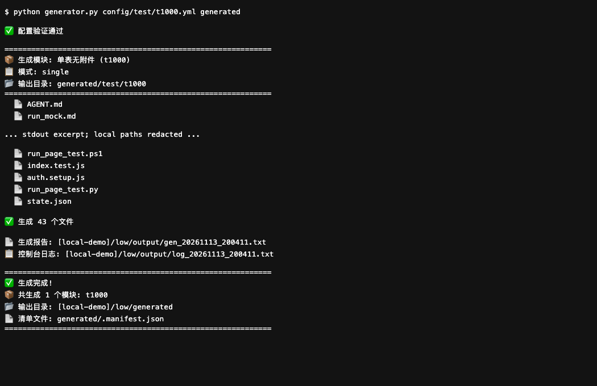
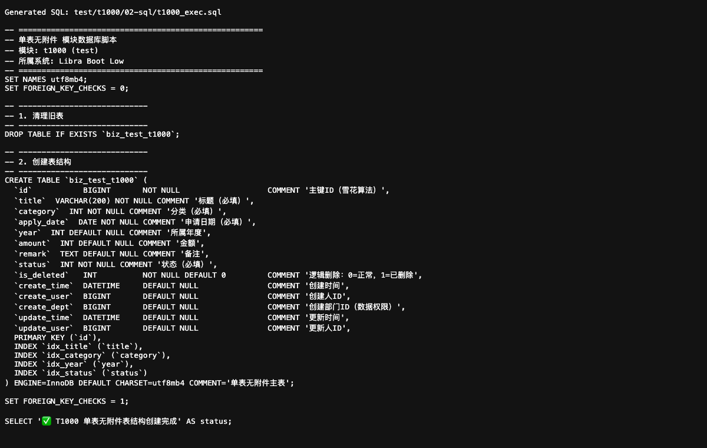

<a id="top"></a>
<div align="center">

# 🚀 Libra Boot Low

**将 YAML 配置与 Jinja2 模板转为 Spring Boot、Vue、SQL 和接口示例的代码生成器。**

[](https://pypi.org/project/libra-boot-low/)
[](https://www.python.org/)
[](https://spring.io/projects/spring-boot)
[](https://vuejs.org/)
[](LICENSE)

[English](README_EN.md) | **简体中文**

</div>

> **本文遵循开源说明规范**：结构与徽章按统一体例，徽章仅指向公开可访问资源，版本信息指向发布渠道动态页。

---

## 📖 目录

- [快速开始](#quick-start)
- [安装与源码](#installation)
- [运行截图](#screenshots)
- [生成模式](#modes)
- [产物与接入](#output)
- [配置与命令](#cli)
- [目录结构](#structure)
- [验证范围](#verification)
- [贡献指南](#contributing)
- [License](#license)
- [联系我们](#contact)
- [Star History](#star-history)
- [回到顶部](#back-to-top)

---

<a id="quick-start"></a>
## 🚀 快速开始

完整生成需要源码中的 `templates/` 与 `config/`；Python 基线见 [pyproject.toml](pyproject.toml)：

```sh
git clone https://github.com/halavah/libra-boot-low.git
cd libra-boot-low
python3 -m venv .venv
# macOS / Linux
source .venv/bin/activate
# Windows PowerShell: .venv\Scripts\Activate.ps1
python -m pip install -r requirements.txt
python generator.py config/test/t1000.yml generated --dry-run
python generator.py config/test/t1000.yml generated
```
预览只列出计划文件，不写产物或报告；第二条生成命令将示例模块写入 `generated/test/t1000/`，并生成清单与 `output/` 运行报告。生成器不会执行 SQL 或启动应用。始终显式指定输出目录，CLI 默认位置位于仓库外。

<a id="installation"></a>
## 📦 安装与源码

源码：[GitHub](https://github.com/halavah/libra-boot-low) · [Gitee](https://gitee.com/halavah/libra-boot-low)，公开仓，主线 `master`。

文档：本篇、[配置说明](config/README.md) 及 `config/test/` 的示例。

| 渠道 | 状态 | 范围 |
|---|---|---|
| 克隆源码并安装 `requirements.txt` | 推荐，已在本地运行 | 包含模板及示例配置 |
| [PyPI](https://pypi.org/project/libra-boot-low/) | 已发布 | 当前 wheel 未包含模板和示例配置，不是完整生成路径 |
| [GitHub Releases](https://github.com/halavah/libra-boot-low/releases) | 发布渠道 | 以实际附件为准，不写死文件名或版本 |

版本以发布渠道为准；仅安装当前 PyPI wheel，不等于获得完整源码生成环境。

<a id="screenshots"></a>
## 🖼️ 运行截图

第一张为实际 CLI 输出的浏览器呈现，日志做了节选并隐藏本机路径；第二张为真实生成的 SQL，不代表已执行建表。





<a id="modes"></a>
## 🧩 生成模式

通过 `python generator.py --list-modes` 查看当前注册模式。

| 模式 | 用途 |
|---|---|
| `single` | 单表 |
| `single-with-file` | 单表与附件 |
| `multi-table` | 多张独立表 |
| `multi-table-with-file` | 多表与附件 |
| `master-detail` | 主从表 |
| `master-detail-with-file` | 主从表与附件 |
| `master-detail-modules` | 模块化明细 |
| `master-detail-modules-with-file` | 模块化明细与附件 |
| `master-details-tabs` | 主多明细页签 |
| `master-details-tabs-with-file` | 多明细页签与附件 |
| `master-details-tabs-dialog` | 页签弹窗 |
| `master-details-tabs-dialog-with-file` | 页签弹窗与附件 |
| `cloud-service` | 独立服务契约、模型及服务 |

<a id="output"></a>
## 📂 产物与接入

```text
generated/
├─ .manifest.json
└─ test/t1000/
   ├─ 00-inbox/               # 输入占位
   ├─ 01-design/              # 接口、数据库及界面说明
   ├─ 02-sql/                 # SQL 与演示数据
   ├─ 02-sql-scripts/         # SQL 辅助脚本
   ├─ 03-http/                # HTTP 请求示例
   ├─ 03-http-scripts/        # 请求与验证辅助脚本
   ├─ 04-server/              # Java 后端
   └─ 05-web/                 # Vue 页面与服务
```

实际结构随模式与配置变化。SQL 执行前必须审阅；代码需集成到目标工程，并配置数据库、鉴权、界面组件及按需运行时依赖。生成器不是独立部署平台。

<a id="cli"></a>
## ⌨️ 配置与命令

| 命令／参数 | 作用 |
|---|---|
| `python generator.py --list-modes` | 列出注册模式 |
| `python generator.py config/test/t1000.yml --validate` | 仅验证配置 |
| `python generator.py config/test/t1000.yml --list` | 列出配置模块 |
| `--module CODE` | 选择单个模块 |
| `--mode MODE` | 覆盖生成模式 |
| `--dry-run` | 不落盘预览 |
| `--update-index` | 重建 `config/index.json` |

`bash run.sh` 与 `run.ps1` 提供交互启动器；`--all`、按域过滤属于启动器能力，使用前查看对应帮助。自定义配置从完整 `config/test/*.yml` 复制，保留必填字段及模式专属结构。

<a id="structure"></a>
## 🗂️ 目录结构

```text
generator.py        # CLI
module/             # Configuration, field building and generators
templates/          # Jinja2 templates, grouped by mode
config/test/        # Complete example configurations
tests/              # Configuration, renderer and output tests
run.sh / run.ps1    # Launchers
assets/screenshots/ # README images
```

<a id="verification"></a>
## ✅ 验证范围

```sh
python -m pip install pytest
python -m pytest tests/ -q
```

本地已运行现有测试、单表实际生成及全部示例配置的 dry-run。未验证生成的 Java／Vue 应用编译、SQL 执行或部署后的端到端行为；生成物是待审阅代码，不是已验收运行的业务应用。

<a id="contributing"></a>
## 🤝 贡献指南

获授权协作者从 `master` 创建功能分支，完成验证后提交 PR；公开仓也可先 Fork。保持提交范围明确，写清实际执行的命令及未运行检查。

配置、字段类型和模板调整应附带回归验证。运行现有测试及全部示例配置的 dry-run，检查预览不会生成产物或报告；模板改动还需审查实际生成文件，不对共享数据库执行演示 SQL。

<a id="license"></a>
## 📄 License

[MIT License](LICENSE)。

- ✅ 允许商业使用、修改、分发和私有使用。
- ⚠️ 在副本或实质性部分中保留版权与许可声明；第三方资源仍遵守各自许可。
- 不提供担保，作者不承担许可所述责任。

选择 MIT，便于开发者复用示例与工具，同时保留来源声明。

<a id="contact"></a>
## 📮 联系我们

维护者：[halavah](https://github.com/halavah)。

- [问题反馈](https://github.com/halavah/libra-boot-low/issues)
- [发布渠道](https://github.com/halavah/libra-boot-low/releases)：可通过 Watch → Custom → Releases 订阅发布。

<a id="star-history"></a>
## ⭐ Star History

如果项目对您有帮助，欢迎 Star 支持。

[](https://star-history.com/#halavah/libra-boot-low&Date)

<a id="back-to-top"></a>
## ⬆ 回到顶部

用 ❤️ 构建 | Made with ❤️

如果这个项目对您有帮助，欢迎给予 Star 支持。

[⬆ 回到顶部](#top)
