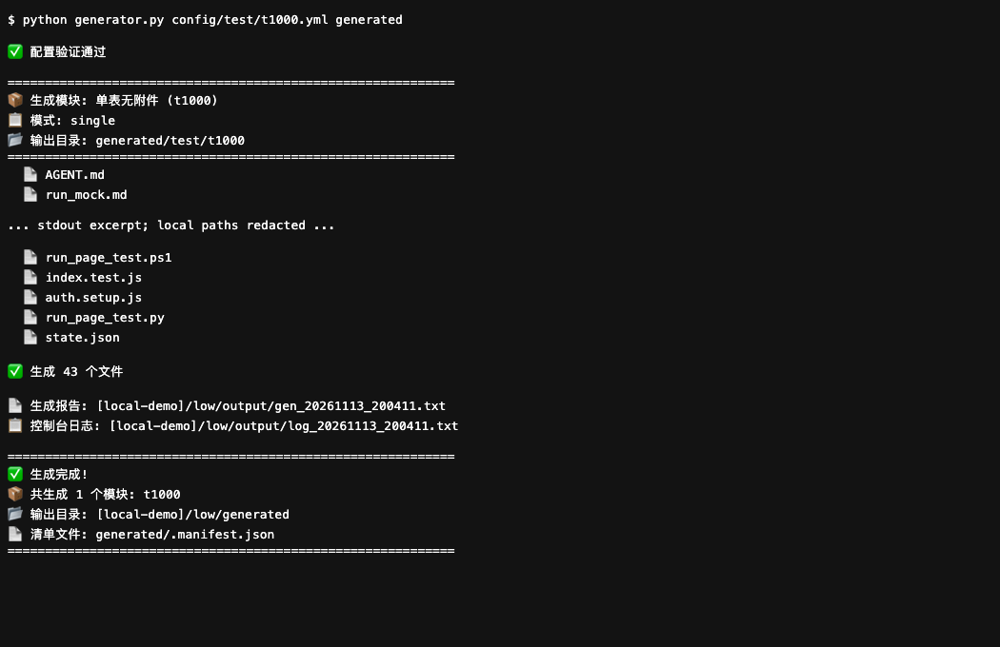
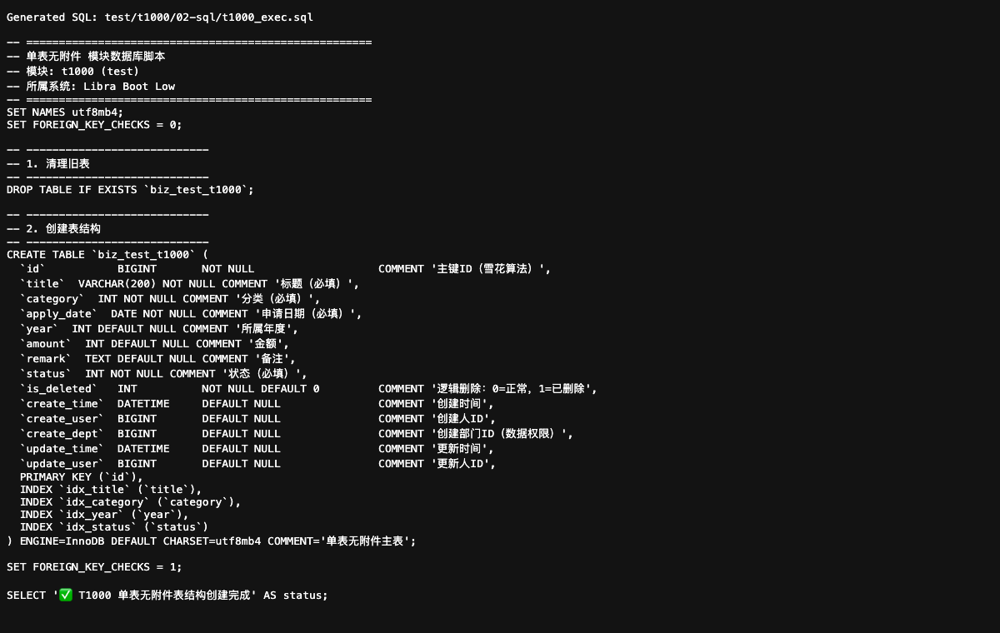

<a id="top"></a>
<div align="center">

# 🚀 Libra Boot Low

**A YAML and Jinja2 code generator for developers building Spring Boot and Vue business scaffolding.**

[](https://pypi.org/project/libra-boot-low/)
[](https://www.python.org/)
[](https://spring.io/projects/spring-boot)
[](https://vuejs.org/)
[](LICENSE)

**English** | [简体中文](README.md)

</div>

> This README follows the open-source documentation standard: consistent structure and badges, public badge resources only, and release-channel pages for current versions.

---

## 📖 Contents

- [Quick start](#quick-start)
- [Installation and source](#installation)
- [Running screenshots](#screenshots)
- [Generation modes](#modes)
- [Output and integration](#output)
- [Configuration and CLI](#cli)
- [Structure](#structure)
- [Verification](#verification)
- [Contributing](#contributing)
- [License](#license)
- [Contact](#contact)
- [Star History](#star-history)
- [Back to top](#back-to-top)

---

<a id="quick-start"></a>
## 🚀 Quick start

The complete generator needs the source tree, including `templates/` and `config/`. Use Python meeting [pyproject.toml](pyproject.toml)’s requirement:

```sh
git clone https://github.com/halavah/libra-boot-low.git
cd libra-boot-low
python3 -m venv .venv
# macOS / Linux
source .venv/bin/activate
# Windows PowerShell: .venv\Scripts\Activate.ps1
python -m pip install -r requirements.txt
python generator.py config/test/t1000.yml generated --dry-run
python generator.py config/test/t1000.yml generated
```
The preview lists planned files without writing output or reports. The second command writes the sample module beneath `generated/test/t1000/`, plus a manifest and an `output/` run report. Generation does not execute SQL or launch the generated application. Always pass an explicit output directory; the CLI default points outside the repository.

<a id="installation"></a>
## 📦 Installation and source

Source code: [GitHub](https://github.com/halavah/libra-boot-low) · [Gitee](https://gitee.com/halavah/libra-boot-low), public, branch `master`.

Documentation: this README, [configuration notes](config/README_EN.md), and example files under `config/test/`.

| Channel | Status | Scope |
|---|---|---|
| Source clone + `requirements.txt` | Recommended; exercised locally | Includes templates and sample configuration |
| [PyPI](https://pypi.org/project/libra-boot-low/) | Published | Current wheel lacks templates and sample configuration; not the complete generation path |
| [GitHub Releases](https://github.com/halavah/libra-boot-low/releases) | Release channel | Check actual assets; no filename/version is assumed here |

Package versions follow the release channels. Installing the current PyPI wheel alone is not equivalent to running the full source tree.

<a id="screenshots"></a>
## 🖼️ Running screenshots

The first image is an excerpt of actual CLI output displayed in a browser, with local paths redacted. The second shows generated SQL, not a database execution result.





<a id="modes"></a>
## 🧩 Generation modes

Run `python generator.py --list-modes` for the current registry.

| Mode | Purpose |
|---|---|
| `single` | Single table |
| `single-with-file` | Single table with attachments |
| `multi-table` | Independent tables |
| `multi-table-with-file` | Independent tables with attachments |
| `master-detail` | Master/detail |
| `master-detail-with-file` | Master/detail with attachments |
| `master-detail-modules` | Modular detail tables |
| `master-detail-modules-with-file` | Modular detail tables with attachments |
| `master-details-tabs` | Multiple detail tabs |
| `master-details-tabs-with-file` | Detail tabs with attachments |
| `master-details-tabs-dialog` | Tabbed detail dialogs |
| `master-details-tabs-dialog-with-file` | Tabbed dialogs with attachments |
| `cloud-service` | Separate service contracts, model and service |

<a id="output"></a>
## 📂 Output and integration

```text
generated/
├─ .manifest.json
└─ test/t1000/
   ├─ 00-inbox/               # Input placeholder
   ├─ 01-design/              # API, database and UI notes
   ├─ 02-sql/                 # SQL and data examples
   ├─ 02-sql-scripts/         # SQL helper scripts
   ├─ 03-http/                # HTTP request examples
   ├─ 03-http-scripts/        # Request/testing helpers
   ├─ 04-server/              # Java backend
   └─ 05-web/                 # Vue pages and services
```

The exact structure depends on mode and options. Review SQL before execution, integrate generated code into your target project, and supply its database, authentication, UI components and optional runtime dependencies. The generator is not a standalone deployment platform.

<a id="cli"></a>
## ⌨️ Configuration and CLI

| Command/option | Effect |
|---|---|
| `python generator.py --list-modes` | List registered modes |
| `python generator.py config/test/t1000.yml --validate` | Validate configuration only |
| `python generator.py config/test/t1000.yml --list` | List configured modules |
| `--module CODE` | Select one module |
| `--mode MODE` | Override its mode |
| `--dry-run` | Preview without writing files |
| `--update-index` | Rebuild `config/index.json` |

`bash run.sh` and `run.ps1` provide the interactive launcher. `--all` and domain filtering belong to that launcher; inspect its help before using them. Start custom configurations from a complete `config/test/*.yml`, keeping required fields and mode-specific structures.

<a id="structure"></a>
## 🗂️ Structure

```text
generator.py        # CLI
module/             # Configuration, field building and generators
templates/          # Jinja2 templates, grouped by mode
config/test/        # Complete example configurations
tests/              # Configuration, renderer and output tests
run.sh / run.ps1    # Launchers
assets/screenshots/ # README images
```

<a id="verification"></a>
## ✅ Verification

```sh
python -m pip install pytest
python -m pytest tests/ -q
```

Local checks exercised the existing tests, real single-table generation, and dry-run across the example configurations. Generated Java/Vue application compilation, SQL execution and deployed end-to-end behavior were not tested. Treat generated files as code for review, not a certified running application.

<a id="contributing"></a>
## 🤝 Contributing

Authorized collaborators create a feature branch from `master`, validate their changes and submit a PR. Public repositories may be forked first. Keep changes focused and state the commands run and any checks omitted.

Add regression coverage for configuration, types and templates. Run the existing tests and all example configurations in dry-run mode; verify that dry-run creates neither generated output nor reports. Review real generated files after template changes. Do not run generated SQL against shared databases.

<a id="license"></a>
## 📄 License

[MIT License](LICENSE).

- ✅ Allows commercial use, modification, redistribution and private use.
- ⚠️ Keep the copyright and permission notice in copies or substantial portions. Third-party resources retain their own licenses.
- No warranty or liability is provided.

MIT keeps reuse straightforward while preserving attribution.

<a id="contact"></a>
## 📮 Contact

Maintainer: [halavah](https://github.com/halavah).

- [Issues](https://github.com/halavah/libra-boot-low/issues)
- [Releases](https://github.com/halavah/libra-boot-low/releases) — use Watch → Custom → Releases to follow releases.

<a id="star-history"></a>
## ⭐ Star History

If this project is useful, consider starring it.

[](https://star-history.com/#halavah/libra-boot-low&Date)

<a id="back-to-top"></a>
## ⬆ Back to top

Made with ❤️. If this project helps you, consider giving it a Star.

[⬆ Back to top](#top)
